# 310P AICore×AICPU 协同模式开发进展（V2，xcclpp aicpu-aicore-310p3 迁移）

> **文档状态：过程记录（2026-09-11 冻结；2026-09-17 增补 V2.1 轮，见 §〇'）**
> 技术内容已沉淀至 `docs/310p/`（机制档案 / 部署档案 / 平台事实档案），
> 行为契约已固化至 `openspec/specs/smem/310p-shm-overlap/`。本文档保留完整的决策、
> 验收与踩坑历史；〇~九章为 2026-09-10/11 冻结时点快照——其中 mode13 双模式/初始化冒烟/
> 双入口 API/四角色三阶段/8.02x 等描述已被 §〇' 精简轮**取代**，勿按旧章节理解现状；
> 若与档案冲突，以档案为准。

> **状态：P0/P1/P2 完成 + P3 核心项完成（2026-09-10）；V2.1 纯流水精简与产品化收敛完成
> （2026-09-12~17，14 提交，见 §〇'：API 合并为单一 submit/launch(chunks)、初始化冒烟移除、
> 示例两角色两阶段+MPI 会合）；V3 kernel 时序缺陷修复完成（2026-09-17，见 §〇''：尾部
> 100ms 先睡后查诊断修复，旧 7.87x/8.02x 基准系 launch 摊薄假象已勘正为 2.57x）；
> FIP 故障注入集成与 OPP 产品化在 TODO**
> - **V2 勘正**：迁移源 = xcclpp main `examples/tutorials/aicpu-aicore-310p3/`（**AICore×AICPU 协同**，
>   AICore 产数据 → AICPU 编排 SDMA 跨卡搬运 → 对端 AICore 消费，计算-通信重叠）。
>   V1 误选 `aicpu-310p3`（纯 AICPU 搬运、host 每笔 launch、无 AICore 协同）——该方案整体降级为 TODO-0。
> - 已定决策：**SHM API 设备发起**对接（AI_CORE_INITIATE）｜**新 08 示例**实机验收｜**八步闭环 + 多 chunk
>   流水都进一期**｜开关切换 + 探测回退｜部署三段演进（deployer+KFC 先行 → opt-in 自部署 → L0 OPP 终态）
> - **V1 沉淀且直接沿用的结论**（本文引用不重复展开）：SQE 64B 逐字节配方（hcomm 源码级证实，附录 A.1）、
>   部署链运维规则与文件系统边界实测（同卡共享/跨卡独立，A.4）、六级初始化地图（D4）、
>   L0 三堵墙与解锁条件（TODO-1）、CP 流配方（A.3）
> - 上游依赖：xcclpp main（PR #27/#28 合入）；机制知识档案 `aicpu-310p3/README.md`（fork 源的共享地基）；
>   本仓 `310p-2rank-vmm-开发计划.md`（AclVmm 池化前置，已验收）；`docs/架构概览.md`（第 3/4/6 章背景）

## 〇、实现总结（2026-09-10 收官，28 提交 / 40 文件 / +6199 行）

> **V2.1 注**：本节为收官时点快照，0.1~0.6 中 mode13 双状态机/五步冒烟/五件套与双入口
> API/四角色三阶段等形态描述已被 §〇' 精简轮取代，勘正对照见 §〇'.1。

**一句话**：SHM API 在 310P 此前于 `hybm_init`（meta 区 halMem 必败）和 `InitTransManager`
（A3 SDMA 配方必败）两处断链而完全不可用；本工作迁移 xcclpp 的 AICore×AICPU 协同模式
（AICore 产数据 → GM 邮箱委托 AICPU 编排 kernel 直投 SDMA SQE → 对端 AICore 消费），
补齐全部断链并实机验收：八步闭环数据校验 0 mismatch，多 chunk 流水**加速比 8.02x**
（通信完全被计算掩盖；**V2.1 注**：8.02x 为文件会合口径，MPI 栅栏口径复测 7.87x，两者
不可直接比较，见 §〇'）。以下按"写了什么代码 → 怎么接入 → 怎么跑起来 → 验收证据"展开。

### 0.1 交付物：新写了哪些代码

#### A. AICPU 编排 kernel（设备侧，hcc 交叉编译）——`src/hybm/ops/hybm_kernel/`

| 文件 | 行数 | 内容 |
|---|---|---|
| `hybm_overlap_kernel.cc` | 784 | 入口 `HybmOverlapRun`：mode13（单 chunk 八步闭环）/ mode14（多 chunk 流水）状态机。核心函数：`cp1LiveQuery`（CP1 内活查询 SQ 环 BASE/DEPTH/HEAD/TAIL）、`querySsidAndStamp`（SMMU ssid 实时查询）、`buildStarsSdmaSqe`（64B SQE 逐字段构造，配方经 hcomm 源码级证实）、`submitSqe`（直写 SQ 环 + `dc cvac` 刷 cache + doorbell，攒批模式）、`doorbellViaHal`（`halSqCqConfig(SQ_TAIL)`）、`pollSlot`（预算制 dcci 轮询）、`timelineMark`（`cntvct_el0` 打点） |
| `hybm_overlap_contract.h` | 102 | host ↔ kernel wire 契约：`HybmOverlapParam`（120B，含 `roleRsv[1]`=chunk 数等 mode14 字段）、`HybmOverlapResult`（56B，`mainRet/stage/headAfter` 诊断面包屑）、`StarsChannelInfo`（64B，shmem wire 同构）；static_assert 锁死布局 |
| `CMakeLists.txt` 修改 | +61 | 新目标 `mf_overlap_kernel`：hcc 编 `libmf_overlap_aicpu.so` + 双 json 生成（CUST 迁移用 / AICPUKernel launch 用，版本名 `MF_OVERLAP_KVER` 独立于主 kernel——CP1 按文件名 dlopen 缓存）+ install |

#### B. 引擎层（hybm）——资源准备与提交

| 文件 | 行数 | 内容 |
|---|---|---|
| `entity/hybm_overlap_prep.h/.cpp` | 132+381 | **进程级单例 `HybmOverlapPrep`**（多池共享，引用计数，归零释放）。公开接口：`SwitchOn()`（读环境变量）/`Acquire(devId)`（首次全量初始化）/`Release()`/`Ready()`/`GetSqId()/GetStreamId()/GetDieId()/GetWorkspace()`/`LaunchOrchestrator(param)`/`WaitOrchestrator()`。私有五步：`InitCpStream`（`ACL_STREAM_DEVICE_USE_ONLY` 流 + `rtStreamGetSqid`）→ `AllocWorkspace`（4KB HUGE_FIRST：mailbox ring 64 槽/sentinel/result/ovf）→ `LoadOrchestratorKernel`（`aclrtBinaryLoadFromFile` cpuMode=0 + `GetFunction`，json 路径可由 `MF_310P_OVERLAP_JSON` 指定）→ `SmokeTest`（E0a 式 SQE 对自证，`CheckSmokeResult` 校验 magic/状态机/head 前进/标志/数据抽样——不过则 `ready_` 不置位、显式报错）→ 就绪。`LaunchOrchestrator` 走仓库既有 `KernelArgsInit/Append/Finalize + LaunchKernelWithConfig` 路径（URMA 同款，attr TIMEOUT=25s < watchdog 30s） |
| `hybm_overlap_capi.cpp` + `hybm_big_mem.h` | 123+57 | hybm 层 C API 五件套：`hybm_overlap_get_info` / `hybm_overlap_submit`（mode13）/ `hybm_overlap_submit_pipelined`（mode14，chunks 校验 1~64）/ `hybm_overlap_wait` / `hybm_overlap_get_result`。内部公共装配 `HybmOverlapSubmitCommon`：哨兵幂等预填 + `HybmOverlapParam` 全字段装配 + launch |

#### C. SHM 层（smem）——用户面 API 与设备头文件

| 文件 | 行数 | 内容 |
|---|---|---|
| `include/host/smem_shm.h` + `csrc/smem_shm/smem_shm.cpp` | +58+85 | 公共 API：`smem_shm_overlap_launch` / `smem_shm_overlap_launch_pipelined` / `smem_shm_overlap_wait` / `smem_shm_overlap_get_result`（出参判空校验）/ `smem_shm_overlap_get_workspace`（host 取工作区地址传给自己的 AICore kernel） |
| `csrc/smem_shm/smem_shm_entry.h/.cpp` | +16+58 | `SmemShmEntry` 转发层：`OverlapLaunch/OverlapLaunchPipelined/OverlapWait/OverlapGetResult/OverlapGetWorkspace`（私有 `OverlapLaunchCommon` 按 chunks 分派 mode13/14） |
| `include/device/smem_shm_aicore_overlap.h` | 140 | **AICore kernel 用的设备头原语**（`SMEM_SHM_INLINE_AICORE`）：`smem_shm_overlap_notify`（写 16B 邮箱 + `SINGLE_CACHE_LINE` clean）、`smem_shm_overlap_poll_flag`（dcci + volatile 轮询，返回非零标志值 + 迭代数）、`smem_shm_overlap_get_flag_addr`（标志保留区定位——按**物理段**末尾，symSize 含 1G 对齐尾部未映射）、`smem_shm_overlap_get_workspace/ready`（meta 偏移读取）；工作区/保留区/轮询上限常量 |

#### D. 测试与实验（真机验收链）

| 位置 | 内容 |
|---|---|
| `test/ut/testcase/hybm/hybm_overlap_prep_test.cpp`（110 行，5 用例全 PASS） | 冒烟防护语义（stub 环境 Acquire 必败且不置 ready/可重试/Release 幂等）/ 未就绪 API 全拒绝 / chunks 边界（参数检查先于就绪检查）/ 工作区布局不变式 / smem 层无效 handle |
| `examples/memory_pool/01_basic/08_310p_aicore_aicpu_overlap/` | 真机验收载体（三阶段含流水加速比量化）：四角色 AICore kernel（单块产/消费 + 流水产/消费）+ 三阶段验收 host（含轮次分区标志槽/轮间会合防数据 hazard/邮箱复位）+ README |

> **验收探针与部署工具未随本 PR 合入**：E0a/E0b/E0c 三级可行性探针、P1 验收探针、
> deployer/mini_kfc 部署工具及一键脚本属开发过程产物（含 xcclpp MIT fork，且 OPP 终态后
> 整段退役），保留在开发环境用于回归，不进产品分支。各验收的判据与实测数字完整记录于
> 本文 0.6 节与 P0/P1 章节。

#### E. 文档

`310p-aicore-aicpu-开发进展.md`（本文档，含〇章实现总结 + 设计决策 D1-D10 + 附录 A hcomm 源码级配方速查）、
`docs/架构概览.md`（新架构文档，含六级初始化地图；平台表 310P 行已更新协同模式）、
能力矩阵索引 17 号条目、08 示例 README。

### 0.2 接入点：改了 MemFabric 的哪些既有代码（每一处都能在 diff 里核对）

| 既有文件 | 改动 | 为什么 |
|---|---|---|
| `entity/hybm_entity_default.cpp`（+30） | `InitTransManager` 在 SDMA 分支前插入 `[SoC==310P && HybmOverlapPrep::SwitchOn()]` 判断：走 `prep.Acquire(devId)` 并 `overlapAcquired_=true`，**不再创建 SdmaTransportManager**（其 A3 配方 `AclnnShmemSdmaStarsQuery` 在 310P 返回 65534 必败）；`SetHybmDeviceInfo` 增填 `overlapWorkspace/overlapFlags`；`ReleaseResources` 对称 `Release()` | **核心挂载点**。选 L2-④ 的原因：SHM 是 `AI_CORE_INITIATE` 会跳过 `InitDataOperator`（算子插槽不可用）；协同准备本质是设备资源准备，与 URMA 在 `OpenDevice` 加载 kernel 同族；此时 store 已连/SoC 已探测/devId 已知 |
| `driver/hybm_gva.cpp`（+50） | 新增 `Hybm310PInitMetaGva`（`AclrtReserveMemAddress` 精确命中硬编码 `HYBM_DEVICE_META_ADDR` + `AclrtMallocPhysical(NONE+P2P_HUGE)` + `AclrtMapMem`）；`hybm_init_hbm_gva` 分派顺序改为 **310P 判断先于 GVA_V4**（310P 驱动被映射为 V4 但无 halMem 语义，误入 `HybmModernInitMetaGva` 则 `HalMemCreate` ret=6 必败——**存量缺陷①**，SHM 之前在 `hybm_init` 就断链） | meta 区是 AICore 读 `HybmDeviceMeta` 的固定设备地址，必须精确命中 |
| `hybm_entry.cpp`（+15） | `hybm_uninit` 增 310P 分支：`AclrtUnmapMem` + `AclrtFreePhysical` + `AclrtReleaseMemAddress`（与创建对称） | 防泄漏，与 ① 配套 |
| `smem/csrc/smem_shm/smem_shm.cpp`（+85） | **存量缺陷②**：`smem_shm_create` 组装 `hybm_options` 时补 `options.devId = SmemShmEntryManager::Instance().GetDeviceId()`——此前**从未透传**（零值初始化恒 0，A3 的 SdmaTransportManager 自取设备所以无感；310P 协同的 `dieId = devId%2` 依赖它，P1 验证时 r1 冒烟超时定位）；其余 85 行为 overlap 五个公共 API 实现 | 08 示例/任何双 die SHM 场景必需 |
| `common/hybm_define.h`（+9） | `HybmDeviceMeta.reserved[11]` 前 2 槽改为具名 `overlapWorkspace/overlapFlags`（**128B 布局不变**，A3 路径零影响）+ `HYBM_OVERLAP_FLAG_READY` 位定义 | AICore 与 host 的设备内存契约（meta 经既有 `SetHybmDeviceInfo` 大页 H2D 写入） |
| `include/hybm_big_mem.h`（+57） | overlap C API 声明 + `hybm_overlap_info_t` | smem 层消费 |
| `util/csrc/mf_env_define.h`（+5） | `MF_310P_SHM_OVERLAP`（总开关，默认关）/ `MF_310P_OVERLAP_JSON` | 遵循 `MF_*` 主命名 |
| `test/ut/CMakeLists.txt`（+1） | include 路径补 `ops/hybm_kernel`（契约头位置） | UT 编译 |

**接入后不变式（回归保障）**：开关关闭时新分支不执行，SHM/BM 行为与改动前完全一致（BM 路径 E0b
回归 PASS、`HybmAclVmmSegmentTest` 67/67 PASS）；开关打开但任一资源缺失时冒烟失败 → 显式报错，
**不静默降级**（SQE 配方固件强相关，错误必须可见）。

### 0.3 一次搬运的完整调用链（用户代码 → SDMA 硬件，逐跳可断点）

```
用户 host 代码                              用户 AICore kernel (bisheng 编译)
─────────────                              ──────────────────────────────
smem_shm_create(SDMA)                        ① smem_shm_overlap_notify(ws+邮箱槽, 数据GVA, words)
 │ smem_shm.cpp: options.devId 修复               │ 设备头原语: 16B 描述符直写 + 行 clean
 │ MemEntityDefault::Initialize                   │ (AICore→AICore 天然一致...指AICPU可见)
 │  └ InitTransManager ←── 【接入点1】             ▼
 │     310P+开关 → HybmOverlapPrep::Acquire      ② (AICPU 侧) HybmOverlapRun(mode13/14)
 │       ├ CP 流(DEVICE_USE_ONLY)+sqId           │ cp1LiveQuery: halSqCqQuery 查 SQ 环
 │       ├ 工作区 4KB (HUGE_FIRST)                │ querySsidAndStamp: SMMU ssid 实时查
 │       ├ BinaryLoadFromFile(cpuMode=0)          │ 逐 chunk: 轮询邮箱 → buildStarsSdmaSqe ×2
 │       └ SmokeTest(SQE 对自证) ← ready          │   (数据SQE: src=邮箱addr → dst=param.dstAddr
 ▼                                                │    标志SQE: 哨兵8B → param.flagDoneAddr)
smem_shm_overlap_get_workspace(shm)              │ submitSqe: 直写 sqBase + dc cvac + 攒批
 │ → 传给 AICore kernel 当参数                     │ doorbellViaHal: halSqCqConfig(SQ_TAIL)
 ▼                                                ▼
smem_shm_overlap_launch(shm, dstGva, flagGva)   ③ 硬件: TSFW 消费 SQE → SDMA 引擎
 │ smem_shm.cpp → SmemShmEntry::OverlapLaunch       (SMMU 按 streamid+ssid 翻译池 GVA)
 │ → hybm_overlap_submit[_pipelined]               ▼
 │   HybmOverlapSubmitCommon:                    ④ 对端池: 数据落位 + 8B 标志写入
 │   哨兵预填 → HybmOverlapParam 装配              ▼
 │   → prep.LaunchOrchestrator                   ⑤ 对端 AICore: poll_flag(dcci) 命中
 │     KernelArgsAppend → LaunchKernelWithConfig    → 读池数据 + INC + ENTIRE clean
 │     (URMA 同款路径)                                → notify 回程邮箱 → 对端 AICPU 反向 ②
 ▼                                                   (两侧 AICPU 同构 role0, E0c 结论)
smem_shm_overlap_wait → SynchronizeStream      ⑥ 本端 AICore: poll_flag 结果标志
smem_shm_overlap_get_result(诊断)                 → host 全量校验(08 示例 mismatch=0)
```

关键点：**AICPU 不解引用池 GVA**（池地址只出现在 SQE 字段，由 SDMA 经 SMMU 翻译——host CPU 解引用
VMM VA 会段错误，AICPU 同样不冒险）；**全内存通知链**（邮箱/池内标志/SQE 对），310P3 上
notify/事件对实测证伪全部弃用；**cache 纪律**（AICore 大块写后 `ENTIRE_DATA_CACHE` clean、
跨执行体读前 dcci、AICPU 写后 cvac+`dsb ish`）固化在 kernel 与设备头原语内。

### 0.4 初始化流程变化（before → after）

**Before（SHM 在 310P 两处断链）**：

```
smem_shm_init → hybm_init → hybm_init_hbm_gva
   └→ [断链1] 310P 误入 V4 分支 → HalMemCreate ret=6 → smem_shm_init 直接失败
smem_shm_create → MemEntityDefault::Initialize → InitTransManager
   └→ [断链2] SdmaTransportManager::OpenDevice → AclnnShmemSdmaStarsQuery 65534 → 实体创建失败
```

**After（六级初始化地图，动了三处）**：

| 级 | 变化 | 代码 |
|---|---|---|
| L1.5 引擎级 | 310P 的 meta 区改走 AclVmm 创建（`ReserveMemAddress` 精确命中 + `MallocPhysical` + `MapMem`），判断先于 V4；`hybm_uninit` 对称释放 | `hybm_gva.cpp: Hybm310PInitMetaGva` / `hybm_entry.cpp` |
| L2-④ 池级 | `InitTransManager` 的 [310P+SDMA+开关] 分支 → `HybmOverlapPrep::Acquire`（CP 流/工作区/kernel/冒烟，进程级单例+引用计数），替代 SdmaTransportManager | `hybm_entity_default.cpp:1251` |
| L2 参数 | `options.devId` 透传修复（`dieId=devId%2` 的依据） | `smem_shm.cpp:54` |
| （配套） | `HybmDeviceMeta` 扩展 2 字段（128B 不变），经既有 `SetHybmDeviceInfo` 写入，AICore 经设备头读 | `hybm_define.h` / `smem_shm_aicore_overlap.h` |

冒烟的时序约束：算子级初始化先于池内存分配（六级地图 L2→L2.5），故 `SmokeTest` 自备 scratch
buffer，不触碰池 GVA；池内真实验证留给验收链（P1 探针/08 示例）。

### 0.5 部署（怎么把 kernel 弄上设备）

- **当前可用**：deployer（`CUSTAICPUKernel` mode=1 迁移落 `/home/CustAiCpuUser/`，不经验签）+
  mini_kfc（KFC 通道设备内 `cat` 到 CP1 搜索路径 `/usr/lib64/aicpu_kernels/0/...`）。run 脚本内置
  `ensure_deploy`（验证门 `test -f`+`grep` 符号 → 缺失自动重部署）。
- **运维铁律（实测教训）**：deployer 保活到期退出会触发清理链**删除设备侧文件**（P1 验收真实复现），
  正式运行前必跑验证门；同卡双 die 共享设备 OS 文件系统（X9 实测），**每卡部署一次即可**；
  KFC `sync=` 即命令退出码（非零→507018），判定看 `sync=0`。
- **产品终态 OPP `.run`**：本机 310P3 被设备端 CMS 验签墙挡（拒收还会毒化宿主进程 aclrtSetDevice
  507033），三堵墙与解锁条件（user-certificate / 环境开关）见 TODO-1；**通道侧代码零障碍**
  （包解压路径即 CP1 搜索路径），墙解即切换、deployer/KFC 整段删除。过渡期可启用
  `MF_310P_AICPU_SELF_DEPLOY=1` 自部署（设计已备：Initialize 内完成 + 配置存储锁串行 + 文件生命周期
  与进程对齐）。

### 0.6 验收证据汇总（全部 dev0↔dev1 真机，一次通过）

| 验收 | 结果 |
|---|---|
| E0a CP1 执行闭环（`probe_e0a`） | 六判据全过：magic=0xA1C0DE01 / mainRet=0+stage=5 / **headAfter 0→2（TSFW 消费 SQE 铁证）** / 标志 SQE 8B 到达 / 数据 1024/1024 / ssid=2 |
| E0b 池 GVA 作 SQE src/dst（`probe_e0b`） | 轮A（纯本地 src→peer 池 GVA）head 0→2 / 轮B（own 池 GVA→peer 池 GVA）head 2→4，数据全对——**SMMU 可译 AclVmm VA（含导入映射），Plan B 不启动** |
| E0c 八步全链（`probe_e0c`） | mismatch=0；**新结论：AICore 可直接 GM 访问池 GVA**；两侧 AICPU 同构 role0 成立 |
| P1 挂载验收（`probe_p1_shm`） | SHM+SDMA 建池成功（310P 首通）/ meta overlap 字段就位 / 第二池引用计数路径 |
| P1 产品化验收（`probe_p1_overlap`） | 八步全链**全走产品 API**，mismatch=0，headAfter=4（冒烟 2+正式 2 自洽） |
| 08 示例三阶段 | ①mode13 闭环 103.76ms（数据校验过）/ ②mode13×8 串行 830.65ms / **③mode14 流水 103.61ms——加速比 8.02x**，1MB 全量 262144 字 mismatch=0，head=36 条 SQE 计数全自洽 |
| UT | 五用例全 PASS；回归 `HybmAclVmmSegmentTest` 67/67、BM 路径（E0b）PASS；`SmemShmTest` 8/27 ASAN 崩溃经对照确认为存量 mockcpp 环境问题（与 310p-2-rank 基线相同进度） |

### 0.7 顺带产出：踩坑与修复记录（对后续开发者有价值）

1. **两个存量缺陷修复**（本工作发现并修复，均影响 310P 上任何 SHM 使用者）：meta 区 halMem 断链
   （修复①）、`smem_shm_create` devId 未透传（修复②）——细节见 0.2 表。
2. **bash 陷阱**：`export X && cmd0 & cmd1 &` 中 `&` 优先级使 export 只作用于第一个后台子 shell
   （第二个进程拿不到变量；E0b/E0c 时代探针不依赖 env 侥幸未爆，P1 排查时定位）。
3. **新增源文件后 CMake GLOB 不自动收编**：必须重新 configure（`cmake -B build`）再 build，
   否则链接旧档案报 undefined reference（UT 构建时复现）。
4. **AICore 工具链差异**：310P3 用 `--npu-arch=dav-2002` + `KERNEL_TYPE_AICORE`（AIV_ONLY 被拒）；
  bisheng 的 `-x asc` 会把后续 `.a` 也当源码，需 `-x none` 切回；clang/lld 需显式 `-lm`；
  AICore kernel 内**不支持 lambda**（辅助函数用文件级 `__aicore__ __inline__`）。
5. **host 指针与 `__gm__` 限定**：host 调用侧用普通指针（`static_cast<uint8_t*>`），`__gm__` 限定
   只出现在 kernel 形参；`static_cast<__gm__ T*>` 会报 "casts away qualifiers"。

## 〇'、纯流水精简与产品化收敛（V2.1，2026-09-12 ~ 09-17，14 提交）

**一句话**：PR 评审期收敛——"单块 = 流水 chunks=1"合并策略从产品 kernel 一路贯彻到示例
（mode13 删除、API 双入口合一、示例角色 4→2），初始化去测试化（冒烟移除），双 rank 会合
改 MPI；全部变更经实机双 rank 复验**行为等价**（加速比 7.87x 两次复测完全一致）。

### 0'.1 勘正对照表（旧章节描述 → V2.1 现状，冲突时以本表为准）

| 冻结章节描述（09-10 时点） | V2.1 现状 |
|---|---|
| kernel 784 行，mode13（八步闭环）/mode14（流水）双状态机 | **438 行**，仅 `SUBMIT_MODE_PIPELINE=14`（域外值 950 拒绝）；mode13 闭环由 chunks=1 等价覆盖，role1/实验钩子全删 |
| 契约 102 行，`roleRsv[1]`=chunk 数 | **96 行**，显式 `chunks` 字段；`MF_OVERLAP_KVER=2`（设备侧 `libmf_overlap_v2.so`）；STAGE 历史中间态枚举值清理（kernel 仅写 ENTRY/DONE） |
| prep 私有五步（…→SmokeTest 自证→就绪） | **三步**（CP 流/工作区/kernel 加载，261+128 行），**冒烟移除**（见 0'.3）；`ready_` = 三步完成即置位 |
| capi 五件套（submit(mode13)/submit_pipelined(mode14)） | **四件套**：`hybm_overlap_get_info` / `hybm_overlap_submit(dst,flag,chunks)` / `wait` / `get_result` |
| smem 双入口（launch/launch_pipelined，`OverlapLaunchCommon` 分派 mode13/14） | **单一** `smem_shm_overlap_launch(handle,dst,flag,chunks)`，分派层删除 |
| 08 示例四角色 × 三阶段 + `/tmp` 文件会合 | **两角色**（role4 产/role5 消费）× **两阶段**（①流水 8×128KB 逐字校验 / ②串行 chunks=1×8 轮对照）+ **MPI_Barrier 会合**（`mpirun -np 2`，rank 由 MPI 分配，worldSize 校验） |
| 加速比 8.02x | **7.87x**（MPI 栅栏口径，2026-09-16/17 两次复测一致；文件口径不可直接比较——栅栏挤掉了串行基线的 1ms 轮询开销，基线更纯） |
| UT "冒烟防护语义"（110 行） | "就绪门控语义"（104 行，5 用例不变全绿；`#define private public` 宏 hack 已删） |
| openspec 契约 | 主 spec 两处需求重写（单一提交接口语义 / 就绪门控），change `simplify-310p-overlap-pipeline-only` 全任务完成 |

### 0'.2 变更清单（全部已推送 wgm-dev-310p）

| 提交 | 内容 |
|---|---|
| `5a8cc20c` | kernel 纯流水精简（784→437 行，mode13/role1/实验位删除，契约 v2/chunks 字段） |
| `928c972a` / `8d92ac97` | host 侧 + smem 层 API 合并为单一 submit/launch(chunks) |
| `ab301e7f` / `dd7e6687` | 08 示例两阶段验收改造 / UT 对齐（五用例语义不变） |
| `e26f61b5` | openspec 立项 + 主 spec 同步单一提交接口语义 |
| `aeea4c96` | 08 示例会合改 MPI（替代 /tmp 文件轮询，净 -23 行） |
| `127b95b5` / `1a789a0a` / `69dd1021` | 逐行中文注释收编 19 文件（原 wgm-dev-916 注释分支删除，改 PR 分支单分支制，strip 比对零语义漂移） |
| `3d882dfc` | 示例 AICore kernel 四角色合并两角色（role2/3 与 role4/5+chunks=1 逐语句等价，仅面包屑码不同且阶段②不查） |
| `d618b21e` | **初始化冒烟移除**（三步就绪门控，spec 需求重写，净 -116 行） |
| `fb7b45fa` | README 补 7.87x 实机复测基准 |
| `a09148d4` | 冗余清理（死 include/示例 kernel 死参数 physSize/STAGE 中间态枚举/UT 宏 hack/魔数常量化/过时注释） |

### 0'.3 关键决策记录

- **D2 反转（冒烟移除）**：初始化保持精瘦（职责分离），固件契约的端到端验证移交 08 示例
  阶段①逐字校验。安全性核查：生产 submit 每次**幂等预填自己的哨兵**（0xE0ECA001），冒烟
  哨兵（0xC0FFEE11）不进生产数据面，删除无隐藏依赖。代价如实登记：固件升级致 SQE 配方
  失效的暴露点从"建池六判据精确定位"退到"示例首传超时/校验失配"——诊断仍可凭 result
  面包屑（mainRet/stage/headAfter）分层定位。
- **保留项**（评估后不动）：Result 56B 诊断面包屑字段（host 暂不读；删除 = 布局锁破裂 +
  KVER bump v3 + 重部署，成本 > 收益）；kernel `timelineMark` 诊断路径（`timelineAddr` 恒 0
  关闭，保留为性能打点开关）；SubmitMode 单值枚举（wire 域检查安全网，950 fail-fast）。
- **MPI 双套纪律**：本机发行版 openmpi 4.1.2（`/usr/bin/mpirun`，编译需 `-DOMPI_SKIP_MPICXX`）
  与 `/usr/local/openmpi` 4.1.5 并存——**编译与启动必须同一套**（混用段错误，实测）。
- **注释单分支制**：注释分支内容收编进 PR 分支后删除，评审直接看 PR diff。

### 0'.4 验收与实机复验（2026-09-16 / 09-17 两次，占用态设备）

- **占用态可跑**：设备常驻 ~36GB 负载、hugepages 打满（17427/17427）仍可跑——协同足迹
  ~70MB（2×32MB 池 + 4KB 工作区），秒级完成。
- 结果（两次一致）：①流水 8×128KB=104.25ms，**mismatch=0/262144**，head=16（16 条 SQE 全被
  TSFW 消费，mainRet=0）；②串行×8=820.19ms；**加速比 7.87x**；destroy/uninit/MPI_Finalize
  干净退出（exit 0）。
- 验证门：UT Overlap 五用例全绿（hcomm 用例失败经 stash 对照实证为 overlap 测试先行的
  **顺序污染存量**，与本轮无关）；bisheng 语法门 + 四静态库全量链接 + 单进程规模校验；
  hcc kernel 交叉编译门。

### 0'.5 部署与构建（V2.1 实测版；V3 起设备侧/launch json 文件名为 libmf_overlap_v3）

```bash
# kernel 三产物（standalone 构建，ASCEND_HOME_PATH 须 -D 显式传，环境变量方式无效）
cmake -S src/hybm/ops -B /tmp/build-kernel -DASCEND_HOME_PATH=/usr/local/Ascend/cann-9.1.0
make -C /tmp/build-kernel mf_overlap_kernel   # so + CUST 迁移 json + v2 launch json

# 部署（同卡单次；deployer 保活，其退出后清理链"延迟"删设备文件——正式跑前必验）
./deployer 0 <build-kernel>/hybm_kernel/libmf_overlap_aicpu.json 3600 &
sleep 22 && ./mini_kfc 0 "cat /home/CustAiCpuUser/lib/libmf_overlap_aicpu.so.* > \
  /usr/lib64/aicpu_kernels/0/aicpu_kernels_device/libmf_overlap_v2.so"
./mini_kfc 0 "chmod 644 /usr/lib64/aicpu_kernels/0/aicpu_kernels_device/libmf_overlap_v2.so"
./mini_kfc 0 "grep -q HybmOverlapRun /usr/lib64/aicpu_kernels/0/aicpu_kernels_device/libmf_overlap_v2.so"

# 08 示例（MPI 双 rank；rank 由 MPI 分配，不再 argv 传参；编译命令见示例 README）
export MF_310P_SHM_OVERLAP=1 MF_310P_OVERLAP_JSON=<v2 launch json 绝对路径>
export ASCEND_HOME_PATH=/usr/local/Ascend/cann-9.1.0
mpirun --allow-run-as-root -np 2 /tmp/ex08
```

## 〇''、kernel 时序缺陷修复（V3，2026-09-17，EX09 触发）

**一句话**：EX09（TP matmul+allreduce 通算融合）实测 fused≈serial（加速比 ≤0.99）暴露
固定时延——定位为 kernel 尾部 head 前进诊断的"先睡后查 100ms"（xcclpp P0 探针遗产，
`usleep(100000)` 先于首查执行）；修复后 EX08 流水 104.26ms→**6.59ms**，串行 820.64ms→
**16.94ms**，加速比勘正为 **2.57x**。

### 0''.1 根因与勘正

- **代码**：`for 20 次 { usleep(100000); if (head 前进) break; }` —— 健康路径 head 早已
  前进，但先睡后查使每次 launch 固定 +100ms。数据交付不受影响（SDMA 早已执行、标志已落），
  全部落在 host `overlap_wait()` 的墙钟里，且位于所有计算之后——**不可能被掩盖**。
- **遗产路径**：xcclpp 原版（`xcclpp_p0_aicpu.cpp`，P0 探针语境一次性取证，合理）→
  WP1 迁移忠实 fork → 进入生产热路径后无人重审。
- **勘正**：v2 及之前的 8.02x/7.87x 是"流水 1 次 launch vs 串行 8 次 launch"摊薄固定睡眠
  的度量，**并非通算掩盖**（删掉全部计算比值依然 ~8x）。文档与 README 中"通信完全被
  计算掩盖"的表述作废，以 2.57x 口径为准。
- **EX09 侧结论修正**：同事报告"fused 收益被 AICPU 编排链路 ~12.5ms/chunk 封顶"的归因
  不准——编排循环 µs 级，12.5ms×8=100ms 即单次 launch 尾睡摊到 8 chunk 的错觉。

### 0''.2 修复内容（KVER v3，纯时序零数据面变更）

| 项 | v2 | v3 |
|---|---|---|
| 尾部 head 诊断 | 先睡后查 100ms×20（上限 2s） | **先查后睡** 100µs×20000（上限同 2s），首轮即查典型 µs~ms 命中 |
| pollSlot 退避 | 1ms | 100µs（保亚毫秒级/chunk 生产节奏的流水节拍） |
| 轮询预算 | 24000/chunk（≈24s） | 200000/chunk（≈20s，窗口不变粒度细化） |
| SQE 配方 / wire 契约 120B+56B / 提交路径 | —— | **一字未动** |

`headAfter` 语义微调：由"等到全部消费"变为**采样快照**（实测 head=14/16 即出，数据完整性
由逐字校验保证）；仍是 host 侧唯一区分"SQE 未消费 vs 消费未执行"（ssid/SMMU/固件改配方
类静默失败）的诊断窗口，故保留不删。

### 0''.3 实机复验（2026-09-17，占用态设备，dev0/dev1）

| 指标 | v2 | v3 | 改善 |
|---|---|---|---|
| ①流水 8×128KB | 104.26ms | **6.59ms** | 15.8x |
| ②串行×8 | 820.64ms | **16.94ms** | 48x |
| 加速比 | 7.87x（摊薄假象） | **2.57x** | 诚实口径 |
| 正确性 | mismatch=0 | mismatch=0 | 不变 |

### 0''.4 后续

- EX09 需 rebase 到 v3 基线（json/设备侧文件名 v3）重测：Tlink 预期 ~2-5ms，fused/serial
  比值转正；注意单流 matmul+allreduce 的掩盖收益结构上限为 (Tm+Tl)/max(Tm,Tl) ≤ 2x，
  大幅展示需 Tm 与 Tl 量级接近的负载或跨算子流水。
- 教训入库：探针/取证代码进入热路径必须重新审视时序；含固定开销的 A/B 测量须做绝对
  时延分解（对照带宽×字节物理下界），相对比值对"两侧共有的固定项"不敏感。

## 一、迁移源与目标架构

### 1.1 aicpu-aicore-310p3 是什么（main 已合入，真机实测定论）

**核心机制**：host 在两条 stream 上并发 launch 双 kernel——用户 AICore kernel（`<<<>>>` 直调，
计算）+ AICPU 编排 kernel（`aclrtLaunchKernelWithHostArgs`，CP1 内 SQE 直投）——三方经 GM 内存协同：

```mermaid
graph LR
    subgraph CARD0["卡0 (发送方)"]
        AC0["AICore kernel<br/>产 pattern + ENTIRE clean"]
        OR0["AICPU 编排 kernel<br/>role0 状态机"]
        MB0["GM 邮箱 16B/slot<br/>{dataAddr, dataLen}"]
    end
    subgraph CARD1["卡1 (接收方)"]
        AC1["AICore kernel<br/>dcci 轮询 ready → +INC"]
        OR1["AICPU 编排 kernel<br/>role1 状态机"]
        ARR["GM 到达标志<br/>(SDMA flag-SQE 写)"]
        RDY["GM ready 标志<br/>(AICPU cvac 写)"]
    end
    AC0 -- "①写邮箱+行clean" --> MB0
    MB0 -- "②AICPU dcci 轮询" --> OR0
    OR0 -- "③SQE 对(数据+到达标志)一次 doorbell" --> ARR
    ARR -- "④AICPU civac 轮询" --> OR1
    OR1 -- "⑤写 ready(cvac)" --> RDY
    RDY -- "⑥AICore dcci 轮询" --> AC1
```



**八步闭环（kernel mode 13，单 chunk）**：①卡0 AICore 产 pattern（+`ENTIRE_DATA_CACHE` clean）→
②mailbox 通知 → ③卡0 AICPU 提交 SQE 对（数据 + 8B 到达标志，一次 doorbell）→ ④卡1 AICPU 轮询到达
写 ready → ⑤卡1 AICore +INC（+ENTIRE clean）→ ⑥卡1 AICPU 提交回程 SQE 对 → ⑦卡0 AICore 见结果标志 →
⑧全量校验。

**多 chunk 流水（mode 14，`roleRsv[1]`=chunk 数）**：mailbox ring（16B/slot）+ arrival/ready/result
标志数组，逐 chunk doorbell；FIFO 保序保证"标志到即数据到"。**稳态周期 = AICore 单 chunk 计算时间
→ SDMA 通信被计算完全掩盖**（实测 310P3：PCIe 860µs/128KB chunk < AICore 计算 1245µs/chunk，
HCCS 12µs/chunk 完全掩盖，两拓扑流水稳态几乎一致即为佐证）。

**实测定论表**（迁移必须遵守的纪律，源：该目录 README 机制结论）：

| 项 | 定论 |
|---|---|
| AICore→AICPU 写可见性 | 天然一致（裸读即见），无需 invalidate |
| AICPU→AICore 写可见性 | AICore DCache 双向陷阱（读侧 stale + 写侧滞留）；**dcci（`DataCacheCleanAndInvalid` SINGLE_CACHE_LINE）为正解** |
| AICore 大块 GM 写 | **必须 `ENTIRE_DATA_CACHE` clean**（SDMA 只认 GM/一致性点） |
| 双 kernel 并发 | AICore 与 AICPU kernel 可同时常驻，无资源冲突（两条 stream） |
| 跨卡通知 | NOTIFY_RECORD **消费不等于执行**，310P3 上 notify/事件对**全弃用**——通知链一律内存方案 |
| 跨卡导出内存 | **必须 P2P policy** 分配（普通分配 import 507899） |
| AICore 计时 | dav-2002 无 cycle 计数器（`GetSystemCycle` 返回 0 且拖慢 8 倍，勿用）；等待段用 dcci 迭代数近似；AICPU 侧用 `cntvct_el0` |
| 轮询预算 | mode13 单 chunk 24000 迭代 ≈ 20s；mode14 按 chunk 数放大（共享预算不放大 → 前 chunk 偏慢耗尽后续预算误判超时）；上限 < watchdog 30s |

### 1.2 MemFabric 对接面：SHM API（AI_CORE_INITIATE）

SHM API 是 MemFabric 的设备发起语义：各 rank 贡献等量对称内存（`gva + symmetric_size * i` 纯算术
互访），GVA 可直接传入 AICore kernel。A3 上的现状（本计划要镜像到 310P 的对象）：

- `smem_shm_create`（`HYBM_TYPE_AI_CORE_INITIATE`，MTE 默认 + 可选 SDMA/RDMA op 位）；
- `SdmaTransportManager::OpenDevice` 准备设备资源：48 个 STARS stream + 16KB 共享 workspace +
  `AclnnShmemSdmaStarsQuery` 查询元数据 → 写入设备内存 `HybmDeviceMeta.sdmaWorkSpace`
  （`hybm_entity_default.cpp:1026-1040`）；
- AICore kernel 经 `src/smem/include/device/smem_shm_aicore_*.h` 设备头文件读 meta，**自己投 SQE**。

**310P 差距（本计划的存在理由）**：310P 的 AICore（dav-2002）**不能投 STARS SQE**（无该路径），
且 SHM 的 SDMA 传输准备是 A3 专属配方（`AclnnShmemSdmaStarsQuery` 在 310P 不可用，历史实测 65534）——
**SHM API 当前在 310P 不可用**。协同模式的答案是：AICore 投不了 SQE，改为**写邮箱委托 AICPU 编排
kernel 代投**——AICPU 内 SQE 直投链已全链验证（v43，hcomm 源码级证实，附录 A.1/A.2）。

### 1.3 目标架构：MemFabric 化的协同模式

```
用户 host 代码（08 示例形态）
 ├─ smem_shm_create(...)                          ← SHM 池（AclVmm 对称内存，2-rank 已验收）
 ├─ smem_shm_overlap_launch(shm, role, ...)       ← 新增 host API：装配 param + launch AICPU 编排 kernel
 ├─ userAiCoreKernel<<<1, 0, aiCoreStream>>>(...)  ← 用户 AICore kernel（memfabric 设备头文件辅助）
 └─ smem_shm_overlap_wait(shm)                     ← 新增 host API：sync 两条 stream + 结果校验钩子
```

组件与职责（全部由 MemFabric 提供，用户只写 AICore 计算逻辑）：

| 组件 | 职责 | 形态 |
|---|---|---|
| AICPU 编排 kernel | role0/role1 状态机：邮箱轮询 → SQE 对构造提交 → 标志读写（fork `xcclpp_overlap_aicpu.cpp` mode 13/14） | `src/hybm/ops/hybm_kernel/` hcc 构建，独立 so（KVER 纪律） |
| wire 契约 | host ↔ AICPU kernel 共享 POD（fork `overlap_wire.hpp` 模式，static_assert 锁布局） | 同上目录 |
| 设备头文件 | AICore 侧原语：`overlap_notify`（写邮箱+行 clean）/ `overlap_poll`（dcci 轮询）/ 常量 | `src/smem/include/device/smem_shm_aicore_overlap.h` 新增 |
| 310P 传输准备 | CP 流 + sqId + 工作区（mailbox/flag/sentinel/overflow，**普通设备内存 HUGE_FIRST**）+ `HybmDeviceMeta` 扩展 + 编排 kernel 部署加载 | `InitTransManager` 310P 分支（D4） |
| host API | overlap_launch / overlap_wait / 工作区地址查询 | `smem_shm.h`/`smem_shm.cpp` 扩展 |

**工作区布局决策（D9）**：mailbox/flag/sentinel/overflow/result 放**普通设备内存**
（`aclrtMalloc` HUGE_FIRST，xcclpp 实证 NORMAL_ONLY 落特殊段 SDMA 不可翻译）；**数据地址用池 GVA**
（仅 SDMA 侧经 SMMU 翻译）；AICPU **不解引用池 VA**（F14：VMM VA 是设备地址，CPU 侧解引用段错误——
AICPU 同理不冒险，池内容只经 SDMA 流动）。

### 1.4 与现有设备侧 kernel 基础设施的关系

现有 `HybmBatchRead/Write`（真 AICPU，hcomm 通道代理）与 `copy_extend`（AICore）的对比见 V1 计划
（结论不变：两者均不可用于 310P 协同场景）。**新增近亲对照**：`SdmaTransportManager` 在 A3 上就是
"SHM 设备路径的资源准备者"（STARS 流 + workspace + meta 写入）——本计划的 310P 传输准备是它在 310P
的对应物，只是把"AICore 自己投 SQE"换成"AICore 委托 AICPU 投"。可复用：`HybmDeviceMeta` 写入机制
（`SetHybmDeviceInfo`，大页 H2D）、设备头文件组织形态、`load_kernel.cpp` 的 BinaryLoad 框架。

### 1.5 V1 结论沿用索引

| V1 结论 | 状态 |
|---|---|
| X1 SQE 配方 + hcomm 源码逐字段证实 | **直接沿用**（fork 同源，附录 A.1） |
| X2 提交链 / X3 CP 流配方 | 直接沿用（A.2/A.3） |
| X4 IPC Case A（P2P policy） | 参考（MemFabric 内存面是 AclVmm，E0b 为准） |
| X5 完成检测定案（notify 证伪） | 沿用并强化（协同模式通知链全内存方案） |
| X6/X7 部署链 + 已知坑 | 直接沿用（A.4） |
| X9 文件系统边界（同卡共享/跨卡独立） | 直接沿用（A.4） |
| 六级初始化地图 | 沿用，挂载点从 L2-⑤ 改 L2-④（D4） |
| L0 三堵墙 / 部署三段演进 | 直接沿用（D3/TODO-1） |

## 二、目标与非目标

**目标（一期）**：
1. SHM API 在 310P 落地：`smem_shm_create`（SDMA op 位）→ 310P 协同链路就绪（传输准备 + kernel + 头文件 + host API）；
2. **08 示例**（`examples/memory_pool/01_basic/08_310p_aicore_aicpu_overlap/`）：双 die SHM 池 +
   AICore 产/算 + AICPU 编排，**八步闭环（mode13 类）与多 chunk 流水（mode14 类）双模式**实机验收，
   数据校验 mismatch=0；
3. **通信掩盖效果量化**：时间线打点证明流水稳态 ≈ AICore 单 chunk 计算时间；
4. 开关（`MF_310P_SHM_OVERLAP`，默认关）+ 探测回退（回退 = SHM 报"310P 不支持"明确错误，不静默）；
5. UT 覆盖（传输准备分支 + 回退路径）。

**非目标（一期不做，登记 TODO）**：BM API host 纯搬运路径（V1 方案，TODO-0）、跨卡 PHB（TODO-2）、
Reduce SQE（TODO-4）、CQE（TODO-5）、OPP 产品化（TODO-1）、常驻编排 kernel（watchdog 30s 不允许）。

## 三、设计决策

| # | 决策 | 内容 |
|---|------|------|
| D1 | **开关切换** | `MF_310P_SHM_OVERLAP=1` opt-in；关闭或探测失败时 `smem_shm_create`（SDMA 位）在 310P 返回明确不支持错误（控制台 ERROR 含 deviceId/失败步骤）——不静默降级到错误链路 |
| D2 | **探测回退**（⚠ **V2.1 反转**：初始化冒烟已移除，就绪门控回归三步准备，端到端验证移交 08 示例阶段①逐字校验，见 §〇'.3） | 原设计：传输准备 Initialize 内冒烟（CP 流→sqId→kernel 部署加载→一笔 SQE 写读自备 scratch 校验）；冒烟不过 = 功能不可用报错。scratch 自备（此时池内存未分配，六级地图 L2 时序约束） |
| D3 | **部署三段演进** | 沿用 V1：P0 外部脚本（deployer+KFC）→ P2 起 opt-in 自部署（按卡分组配置存储锁，X9）→ L0 OPP 终态（三堵墙/解锁条件见 TODO-1） |
| D4 | **挂载点 = L2-④ `InitTransManager`** | SHM 是 AI_CORE_INITIATE，**跳过 InitDataOperator**（`hybm_entity_default.cpp:1267-1270`）——与 V1（L2-⑤）不同！310P 分支挂在 SDMA 传输准备处（对照 URMA 在 OpenDevice 加载设备 kernel 的同族先例）；CP 流/sqId/工作区/`HybmDeviceMeta` 扩展/kernel 部署加载全部在此完成 |
| D5 | **通知链定型（全内存方案）** | AICore→AICPU = GM 邮箱（vector 直写 + SINGLE_CACHE_LINE clean）；AICPU→AICore = GM flag（cvac 写 / dcci 轮询）；跨端数据+通知 = SQE 对（数据+8B 标志一次 doorbell，FIFO 保序）。**notify/事件对全弃用**（X5 + 协同实测双重证伪） |
| D6 | **cache 纪律** | AICore 大块写后 `ENTIRE_DATA_CACHE` clean；所有跨执行体读前 dcci（SINGLE_CACHE_LINE）；AICPU 写标志后 cvac + `dsb ish`（kernel 内 `cacheFlushLine/memBarrier` 原语照抄） |
| D7 | **wire 契约单一事实源** | `hybm_overlap_contract.h`：纯 POD + static_assert 锁布局（hcc/g++/bisheng 三工具链可编——AICore 侧头文件也要 include 常量） |
| D8 | **符号层** | `rtStreamGetSqid`（libruntime）等新符号全部进 `DlAclApi` 弱加载（V1 WP2 清单不变） |
| D9 | **工作区布局** | mailbox/flag/sentinel/overflow/result = 普通设备内存（HUGE_FIRST）；数据 = 池 GVA（仅 SDMA 侧）；AICPU 不解引用池 VA（F14 推导） |
| D10 | **kernel 形态** | 单 kernel 双模式（SUBMIT_MODE_CHAIN=13 类 / SUBMIT_MODE_PIPELINE=14 类，fork 语义重编号进 hybm 命名空间）；host 每 op launch（对齐 demo 三流模式：cpStream/launchStream/aiCoreStream），不做常驻 |

## 四、分阶段任务

### P0 可行性关卡（~3 天，三个实验）

**E0a 部署链复刻（~0.5 天，沿用 V1）**：fork `xcclpp_overlap_aicpu.cpp` 进 hybm_kernel hcc 构建
（`libmf_overlap_kernel.so`），复刻 deployer+KFC 链，验收 = 编排 kernel 在 CP1 内执行（result magic）。
> **✅ 已完成（2026-09-10，dev0，一次通过）**——kernel/contract 迁入主构建（见 0.1-A），
> 部署链工具与 probe_e0a 六判据探针位于开发环境（未随 PR 合入，见 0.1-D 说明）。
> 实测：hcc 构建产物 ELF64/AArch64、
> `HybmOverlapRun` 符号导出；部署链纪律化执行（deployer load/getfunc=0 → KFC cat/chmod →
> 双验证门）；探针六判据全过——magic=0xA1C0DE01、mainRet=0/stage=5、**headBefore=0→headAfter=2
> （SQE 对全被 TSFW 消费）**、标志 SQE 8B 到达、数据 1024/1024 字一致、ssid=2 实时查询成功。
> CP 流实测 streamId=240/sqId=241。**出口条件三项（构建/部署链/CP1 内 SQE 直投闭环）全部达成。**

**E0b 关键实验：AclVmm 池 GVA 作 SQE src/dst（~1 天，沿用 V1，仍是最大技术未知点）**：
07 池上发起方 launch kernel，SQE src/dst 直接用池 GVA（own/peer HBM 窗口），逐字校验。
- 通过 → 数据面成立（SMMU ssid 可译 AclVmm 导入 VA）；
- 失败 → Plan B：段层增加 IPC Case A 导入模式（P2P policy + ImportByKey，X4 配方）。
> **✅ 已完成（2026-09-10，dev0↔dev1 双 die 32MB HBM 池，一次通过）——架构成立，Plan B 不启动**。
> 两轮变体双 PASS（`probe_e0b`，隔离诊断设计）：轮A（纯本地 src→peer 池 GVA）headAfter 0→2、
> 数据 1024/1024 一致——**导入 VA 可译**；轮B（own 池 GVA→peer 池 GVA，真实使用形态）headAfter
> 2→4、数据一致——**本端窗口 VA 亦可译**。GVA 对称基址 0x12c140000000（与 07 吻合）、ssid=2
> 实时查询、标志 SQE 8B 到达。AICPU 全程未解引用池 VA（D9 纪律，池地址仅在 SQE 字段）。

**E0c 池上协同最小复现（~1.5 天，V1-E0c 升级）**：在 07 双 die 池上复刻协同三要素——
mini AICore kernel（bisheng dav-2002：写邮箱/轮询 flag）+ 编排 kernel（mode13）+ 池 GVA 数据路径，
八步语义全链走通。验收：跨 die 数据 +INC 校验通过。此实验同时验证 D5 通知链与 D6 cache 纪律。
> **✅ 已完成（2026-09-10，dev0↔dev1，一次通过）——八步全链成立 + 两个关键新结论**。
> `probe_e0c`（bisheng 统一编译 host + AICore kernel，dav-2002 + `KERNEL_TYPE_AICORE`）实测：
> r0 终态数据 mismatch=0/1024 == pattern+0x100（r1 AICore 的 INC 经回程 SQE 覆写）、结果标志
> SENT_B 到达（pollIters≈139 万 = 八步往返可观测度量）、双侧 AICore 状态走满（0xA3/0xB3）、
> 双侧 AICPU mainRet=0 且 head 各 +2（die0 ssid=2 / die1 ssid=5，按 die 区分实证）。
> **新结论①：AICore 可直接 GM 访问 AclVmm 池 GVA**（写 pattern/读改写 INC/dcci 轮询池内标志
> 全通）——SHM 设备发起语义的基石；**新结论②：两侧 AICPU 同构 mode13 role0 成立**（"到达
> 轮询+ready 通知"上移 AICore 直接 dcci 池内标志，规避 AICPU 解引用池 VA，比 xcclpp 原版
> role0/role1 非对称更简洁）。**P0 全部完成，M0 达成。**

### P1 骨架（~1.5 周，5 个工作包）—— ✅ 已完成（2026-09-10，M1 达成）

> 实施摘要：**WP2 为零代码缺口**（所需 ACL 符号 `CreateStreamWithConfig`/`StreamGetId`/`BinaryLoad`/
> `GetFunction`/`KernelArgs+LaunchKernelWithConfig`/`rtStreamGetSqid` 仓库全部已有，URMA/DlRtApi 先例）。
> WP1 kernel 迁入主构建（`mf_overlap_kernel` 目标，git mv 保留历史）。WP3 传输准备落地
> （`hybm_overlap_prep` 单例 + InitTransManager 分支 + meta 扩展），途中修复**两个存量缺陷**：
> ① SHM meta 区创建走 A3 halMem* 在 310P 失败（新增 `Hybm310PInitMetaGva` AclVmm 路径 + uninit 对称）；
> ② `smem_shm_create` 从未透传 devId（恒 0，310P dieId 依赖——对齐 smem_bm 补 `GetDeviceId()`）。
> WP4 设备头原语（notify/poll_flag/get_flag_addr——标志区按**物理段**末尾定位，symSize 含 1G 对齐
> 尾部未映射）。WP5 host API（hybm C API + smem_shm overlap 族）。
> **P1 验收**（`probe_p1_overlap` + `run_p1_overlap.sh`，dev0↔dev1）：八步全链**全部走产品 API**
> （smem_shm_create → AICore 设备头原语 → smem_shm_overlap_launch/wait/get_result），r0 终态数据
> mismatch=0/1024、双侧 mainRet=0/headAfter=4（冒烟 2+正式 2 条 SQE 自洽）；BM 路径回归（E0b）PASS。
> 运维坑实测复现：**deployer 保活到期退出触发清理链删设备侧文件**——每次正式验证前必跑验证门
> （`run_p1_overlap.sh` 内置 ensure_deploy）。另：bash `export X && cmd0 & cmd1 &` 的 `&` 优先级
> 会使 export 只作用于第一个后台子 shell（E0b/E0c 时代探针不依赖 env 侥幸未爆，P1 排查记录）。

**WP1 编排 kernel + wire 契约**（`src/hybm/ops/hybm_kernel/hybm_overlap_kernel.cc` +
`hybm_overlap_contract.h`）：fork mode13/14 状态机（`cp1LiveQuery`/`querySsidAndStamp`/`buildStarsSdmaSqe`/
`submitSqe`/`doorbellViaHal`/`pollSlot`/timeline 打点全链照抄，SQE 配方锚定附录 A.1）；CMakeLists 入链。

**WP2 DlAclApi 扩展**：V1 WP2 清单原样（`rtStreamGetSqid`/`aclrtCreateStreamWithConfig`/
`aclrtStreamGetId`/`aclrtBinaryLoad*`/`aclrtLaunchKernelWithHostArgs`/notify 族/`aclrtDeviceGetBareTgid`）。

**WP3 310P 传输准备**（`InitTransManager` 310P 分支，新文件如 `hybm_overlap_transport_prep.cpp`）：
读开关 → 建 CP 流（DEVICE_USE_ONLY）+ `rtStreamGetSqid` → 工作区分配（HUGE_FIRST：mailbox ring
16B×N / arrival / ready / result 标志数组 / sentinel / overflow）→ kernel 部署加载（按 D3 当前阶段）
→ 冒烟（D2）→ `HybmDeviceMeta` 扩展字段（cpSqId/cpStreamId/dieId/工作区偏移）写入大页
（`SetHybmDeviceInfo` 机制复用）。多池防重复：进程级单例 + 引用计数。

**WP4 设备头文件**（`src/smem/include/device/smem_shm_aicore_overlap.h`）：
`smem_shm_overlap_notify(mailboxSlot, dataAddr, words)`（vector 直写 + SINGLE_CACHE_LINE clean）、
`smem_shm_overlap_poll(flagAddr)`（dcci + volatile 读）、`smem_shm_overlap_get_workspace(shmemId)`
（读 meta 返回工作区地址）、常量（槽尺寸/超时迭代数）。

**WP5 host API**（`smem_shm.h/.cpp` 扩展）：`smem_shm_overlap_launch(shm, role, mode, dstGva, chunks)`（
装配 param：die 号/sqId/streamId/工作区地址/池 GVA → `LaunchKernelWithHostArgs` 于 launchStream）、
`smem_shm_overlap_wait(shm)`（sync launchStream）、`smem_shm_overlap_get_result(shm)`。

**P1 验收**：E0c 场景产品化重跑（不开用户 kernel，用测试 AICore kernel）；开关关闭时 SHM 行为与
现版本一致（回归）。

### P2 08 示例 + 验收（~1 周）—— ✅ 已完成（2026-09-10，M2 达成）

> **实测（dev0↔dev1，`/tmp/ex08` 双进程）**：① mode13 闭环 103.76ms（数据校验通过）；
> ② mode13×8 串行 830.65ms；③ **mode14 流水 103.61ms——加速比 8.02x（理想线性 8x，
> 通信完全被计算/生产掩盖）**，1MB 全量 262144 字 mismatch=0，head=36 条 SQE 计数全自洽。
> 实施：`hybm_overlap_submit_pipelined`（mode14 公共装配，chunks≤64 邮箱槽约束）+
> `smem_shm_overlap_launch_pipelined`；08 示例四角色 AICore kernel（单块产/消费+流水产/消费），
> 标志槽按轮次分区（免清池内标志）、串行阶段轮间会合（防回程 SDMA 数据 hazard）、
> ResetWorkspace 清邮箱 ring（防旧值污染轮询）。

- 新建 `examples/memory_pool/01_basic/08_310p_aicore_aicpu_overlap/`（README + .asc + 运行脚本，
  对齐 xcclpp demo 结构与 01-07 示例规范）：双 rank 双 die SHM 池 → rank0 AICore 产 pattern →
  协同搬运 → rank1 AICore +INC → 回程 → 校验；
- **mode13 闭环**：1MB 单 chunk 八步，mismatch=0；
- **mode14 流水**：8×128KB，mismatch=0 + **时间线打点证明通信掩盖**（稳态周期 ≈ AICore 单 chunk
  计算时间，两方向时间线 JSONL 输出）；
- 部署：同卡单次部署（X9）；异常退出清理纪律照抄 07（`/dev/shm` 残留清理）。

### P3 加固（~1 周）—— 核心项已完成（2026-09-10）

> **UT**（`hybm_overlap_prep_test.cpp` 五用例全 PASS）：冒烟防护语义（UT stub 环境下
> Acquire 必然失败且不置 ready、可重试、Release 幂等）/未就绪 API 全拒绝/chunks 边界
> （参数检查先于就绪检查）/工作区布局不变式/smem 层无效 handle 拒绝。
> **回归**：`HybmAclVmmSegmentTest` 67/67 PASS；`SmemShmTest` 8/27 处 ASAN 崩溃为存量
> mockcpp 环境问题（与 2-rank 基线相同进度，附录 A4 在案）。
> **性能基线**：即 08 示例三阶段实测（①mode13 闭环 103.76ms / ②串行×8 830.65ms /
> ③流水 103.61ms——加速比 8.02x 理想线性）。**文档**：架构概览第 8 章平台表 310P 行
> 已更新（协同模式入表）。
> **遗留**：FIP 故障注入点集成（prep 失败路径已由 UT 覆盖，FIP 化为锦上添花）；
> OPP `.run` 产品化（TODO-1 三堵墙不变）。

- UT：310P 传输准备分支（mock DlAclApi 符号缺失→回退路径）、contract 布局锁、host API 参数校验；
- 故障注入：kernel 未部署→明确报错、SQE 不消费→轮询预算超时上报（错误码带 die/sqId/chunk 序号）；
- 性能基线：闭环/流水 vs 07 的 AclMemcpy host 编排（单笔与批量两张表）+ 掩盖效果量化表；
- 文档：`docs/` 增 310P SHM 协同模式说明；`docs/架构概览.md` 第 8 章平台表 310P 行更新。

## 五、代码规范

沿用 `AGENTS.md` 全量规范（函数≤50 行、嵌套≤4 层、错误返回 ERROR 日志带关键参数——deviceId/sqId/
dieId/rankId/chunk 序号、行宽≤120）。kernel 侧（hcc）照 `xcclpp_overlap_aicpu.cpp` 风格；
AICore 侧（bisheng）照 demo kernel 风格。每个 P 完成跑改动覆盖路径 UT。

## 六、风险与对策

| 风险 | 等级 | 对策 |
|------|------|------|
| E0b：AclVmm 池 GVA 不被 SDMA ssid 翻译 | **高（唯一可推翻架构项）** | P0 前置；Plan B 段层 IPC Case A（X4） |
| AICore（dav-2002）协同 kernel 编译/行为差异 | 中 | E0c 用 demo 同款工具链（bisheng dav-2002）先行验证；无 cycle 计数器已知（dcci 迭代数近似） |
| SHM 310P 分支与 A3 配方共存 | 中 | 开关隔离（D1）；A3 路径零改动（SoC 分派）；全量 SHM UT 回归 |
| 轮询预算与 watchdog | 中 | 预算按 chunk 数放大（实测纪律）；总预算 < 30s；超时错误码带定位信息 |
| deployer+KFC POC 形态（保活/易失/非特权） | 高 | 一期验收不承诺产品可用；D3 三段演进；探测报错不静默 |
| KFC 进库代码安全评审（自部署阶段） | 中 | R8 沿用（opt-in + 全链日志 + 评审 + OPP 终态删除） |
| AICPU 误解引用池 VA | 低 | D9 设计规避（工作区普通设备内存）；contract 注释明示 |

## 七、里程碑

| 里程碑 | 内容 | 退出条件 |
|--------|------|---------|
| M0 | P0 三实验 | E0a/b/c 报告追加进本文件；E0b 结论明确（通过或 Plan B 立项） |
| M1 | P1 骨架 | E0c 场景产品化重跑 PASS + 开关关闭回归全绿 |
| M2 | P2 验收 | 08 示例闭环+流水 mismatch=0 + 掩盖效果量化表 |
| M3 | P3 加固 | UT 全绿 + 性能基线报告 + 文档合入 |

## 八、验证执行命令（V2.1 实测版见 §〇'.5 与 08 示例 README）

> **V2.1 注**：以下 09-10 占位版命令已过时（v1 文件名 / 双进程 argv 传 rank / 文件会合），
> 留档备查；现行命令以 §〇'.5 为准。

```bash
# 部署（同卡单次，X9）—— 旧版留档
./deployer 0 aicpu_kernel/libmf_overlap_kernel.json 3600 &
sleep 15 && ./mini_kfc 0 "cat /home/CustAiCpuUser/lib/libmf_overlap_kernel.so.* > \
  /usr/lib64/aicpu_kernels/0/aicpu_kernels_device/libmf_overlap_v1.so"
./mini_kfc 0 "grep -q HybmOverlapRun /usr/lib64/aicpu_kernels/0/aicpu_kernels_device/libmf_overlap_v1.so"

# 08 示例（双 rank，AICore bisheng dav-2002 预编译进示例）—— 旧版留档
export MF_310P_SHM_OVERLAP=1
# （构建与运行命令对齐 2-rank 计划第八节模式；二进制勿放 /tmp/p5_e2e——WORK_DIR 自删坑已登记）
```

## 九、TODO（backlog）

- **TODO-0**：BM API host 纯搬运路径（V1 方案：`HostDataOpAicpuSqe` 占 SDMA 槽位 + batch 攒批）——
  V1 计划的 WP1-WP4 设计仍有效，待协同模式落地后按需启动（kernel 可与本计划共用，增补 host
  提交模式即可）
- **TODO-1**：L0 OPP `.run` 产品化部署（D3 终态；三堵墙与解锁条件：user-certificate 或环境验签开关，详见 V1 沉淀分析）
- **TODO-2**：跨卡 PCIe（PHB）拓扑（AclVmm 跨卡导入 + P2P policy 配方，X4）
- **TODO-3**：H2G/G2H 的 SQE 直译（host 内存注册 SMMU 实验）
- **TODO-4**：Reduce SQE（hcomm `AddOneMemcpySqeV2` 的 `ACL_RT_MEMCPY_SDMA_AUTOMATIC_SUM` 分支源码已证生产在用）
- **TODO-5**：完成检测 CQE 化（`halCqReportRecv` 配方已源码锚定；wgm-dev4 B1 受阻记录复核）

## 附录 A：配方速查（实施时直接对照）

### A.1 SQE 64B 布局（v43 破壁版，hcomm 源码级证实——沿用 V1 全文）

> 源码证据：`AddOneMemcpySqeV2`（hcomm `aicpu_hccl_sqcqv2.cc:92-152`）、type 枚举
> （`aicpu_hccl_sqcqv2.h:29`：`RT_HW_STARS_SQE_TYPE_SDMA=9`，0x01 是 AICPU kernel-launch 类）、
> credit 常量（`ascend950/.../sqe.h:24` = 255）。

| 偏移 | 值 | 说明 | hcomm 源码出处 |
|------|-----|------|----------------|
| 0 | `0x09` | MEMCPY_ASYNC_SQE_V2 真实 type | aicpu_hccl_sqcqv2.h:29 |
| 4-5 | streamId | CP 流 rt_stream_id | `sqe->rt_stream_id` |
| 6-7 | taskId | | `sqe->task_id` |
| 8-11 | 全 0 | 0903 fresh dump 勘正 | — |
| 12-15 | credit=0xff | NEVER_TIMEOUT_KERNEL_CREDIT | sqe.h:24 |
| 16-19 | `00 de 0e 00` | opcode=NOT_ATOMIC + sro/dro/sns/dns/sssv/dssv 全 1 + overflow_en + qos | :116-132 |
| 20-21 / 24-25 | SMMU streamid | die0=0x7F45，die1=0xBF45 | :101-106 |
| 22-23 / 26-27 | ssid | 对称=实时查询值（`drvMemSmmuQuery`） | `src/dst_substreamid = ssid` |
| 28-31 | length | | `sqe->length` |
| 32-39 / 40-47 | src / dst（32+32 拆分） | | :123-127 |
| 48-51 | `00 00 20 00` | 模板原样 | overflow_en 位 :130 |
| 52-59 | overflow_addr | | :130-134 |

### A.2 提交序列与流控（沿用 V1）

读 shadow tail（先 `dc civac`）→ 环满判断（used = tail-head）→ SQE 直写 slot → `dc cvac` 逐 cacheline
刷 → doorbell（GM 写 `sqRegBase+0x8` 或 `halSqCqConfig`，CP1 内 HAL devId=**die 号**）→ 回写 shadow
tail。攒批：只推进 shadow tail，整批一次 doorbell（hcomm 生产同款，`dispatcher_aicpu.cc:926-932`）。
**SQE 对纪律**：数据 SQE + 标志 SQE（8B 哨兵搬运）成对提交、一次 doorbell——FIFO 保序保证标志到即数据到（协同模式跨端通知的基石）。

### A.3 CP 流与双 kernel launch 模式（host 侧）

三流结构（demo 实测）：
1. **cpStream**：`aclrtCreateStreamWithConfig(0, ACL_STREAM_DEVICE_USE_ONLY)` + `rtStreamGetSqid`
   ——只为取 sqId/streamId（SQ 注册进 CP1 trs 表，kernel 内 `halSqCqQuery` 可查）；
2. **launchStream**：普通流，`aclrtLaunchKernelWithHostArgs(funcHandle, 1, launchStream, nullptr, &param,
   sizeof(param))` launch AICPU 编排 kernel；
3. **aiCoreStream**：普通流，用户 AICore kernel `<<<1, 0, aiCoreStream>>>`。

param 装配要点（demo :440-500）：`devId=die 号`（host 设备号 %2）、`sqId/cpStreamId`、`submitMode`、
`overflowAddr/resultAddr`（HUGE_FIRST 设备内存）、`mailboxAddr/timelineAddr`、`role`（0=发送方 /
1=编排方）、`roleRsv[1]`=mode14 chunk 数、role0 的 `dstAddr`=对端数据区、`flagDoneAddr`=对端到达标志、
role1 的 `dstAddr`=发起方结果区。

### A.4 部署链运维规则（沿用 V1 全文，含 X9 实测）

1. deployer 并发互斥作用域 = **卡**（同卡双 die 共享设备 OS 文件系统，跨卡独立，X9 实测）；
   **部署粒度 = 每卡一次**；
2. deployer json 必须 `CUSTAICPUKernel`（mode=1 落真 ELF）；launch json 必须 `AICPUKernel` + cpuMode=0；
3. 复制时改名（PID 后缀多版本拼接 = 损坏 ELF）；改 kernel 必 bump KVER（CP1 按文件名 dlopen 缓存）；
4. 正式验证前跑验证门（`test -f` + `grep -q <symbol>`）；
5. KFC：单条短命令；**sync = 命令退出码**（0→sync=0，非零→507018），确定性失败重试不会过；
6. NOTIFY 通道已证伪（不触发 + 流内 wait 挂死），通知链一律内存方案（D5）；
7. result/ovf buffer 必须 `ACL_MEM_MALLOC_HUGE_FIRST`。

### A.5 通知链三件套与 cache 纪律（新增，aicpu-aicore 实测定论）

| 通道 | 方向 | 配方 | cache 动作 |
|------|------|------|-----------|
| GM 邮箱 | AICore→AICPU | 16B/slot `{dataAddr, words}`，vector 直写 | 写后 `SINGLE_CACHE_LINE` clean；AICPU 读侧天然一致 |
| GM flag | AICPU→AICore | `*flag = value` | AICPU 写后 cvac + `dsb ish`；AICore 读前 dcci（`DataCacheCleanAndInvalid` SINGLE_CACHE_LINE）+ volatile 读 |
| SQE 对 | 跨端数据+通知 | 数据 SQE + 8B 标志 SQE 一次 doorbell | FIFO 保序保证标志到即数据到；对端 AICPU `dc civac` 轮询标志 |
| 大块数据 | AICore 产出后 | — | AICore 写后**必须 `ENTIRE_DATA_CACHE` clean**（SDMA 只认 GM） |

### A.6 编排状态机要点（fork 时对照 kernel 源码）

- **role0（发送方）**：`cp1LiveQuery` → ssid 查询 → 轮询邮箱（预算 24000×chunks）→ SQE 对
  （src=邮箱描述符地址，dst=param.dstAddr）→ 攒批 doorbell → head 前进诊断（2s 上限，TSFW 消费证据）；
- **role1（编排方）**：轮询本地到达标志 → 写 ready（透传 magic）→ 轮询回程邮箱 → 回程 SQE 对 → doorbell；
- **mode14 流水**：mailbox ring 逐 slot、arrival/ready/result 数组逐 chunk、dst 逐 chunk 递增
  （`dstAddr + c * words * 4`）、FIFO 保序只需等 `result[N-1]`；
- timeline 打点（`cntvct_el0`，16×u64 槽，0=关闭）：[0]入口 / [1]邮箱或到达命中 / [2]SQE 提交完 /
  （role1）[2]ready 写完 [3]回程邮箱 [4]提交完——性能基线与掩盖效果量化的数据源；
- 错误码规约（fork 后保留并 hybm 化）：1300=liveQuery 失败 / 1320-1321=正向提交失败 /
  1410=数据 20s 未到 / 1420=AICore 未完成 / 1430-1431=回程提交失败 / 1350+c=chunk c 邮箱超时 /
  1390=doorbell 失败——**全部回写 result 区 + cvac + mainRet 语义化**。
